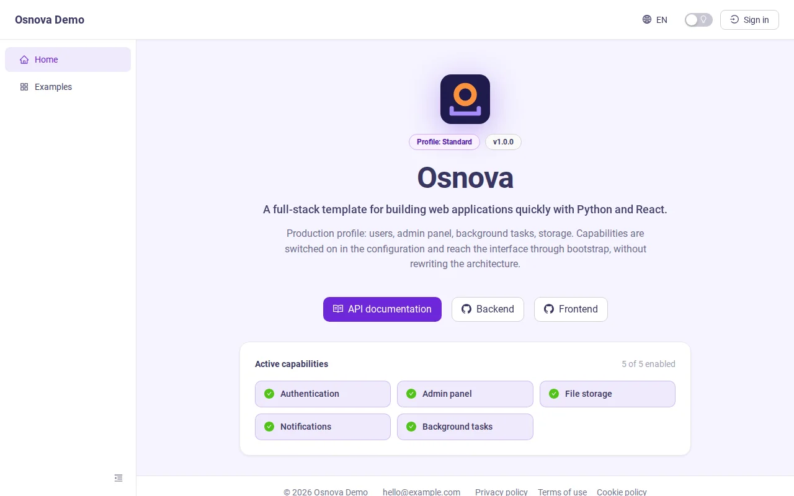
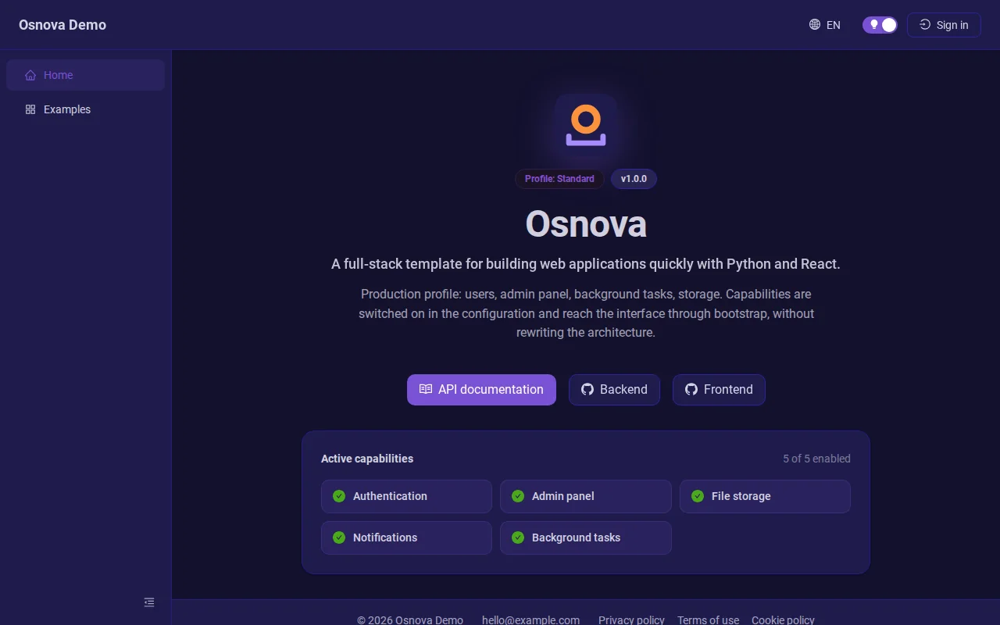
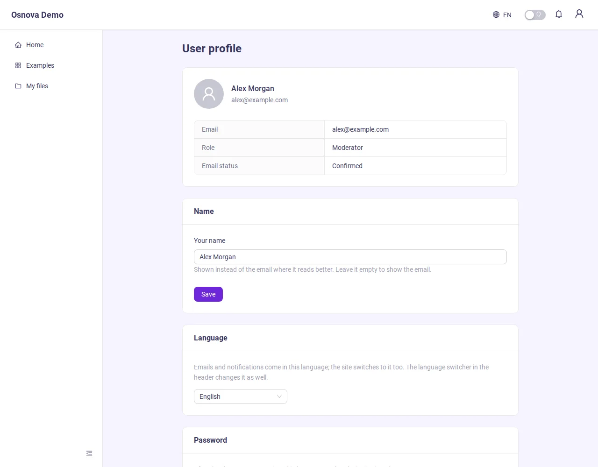
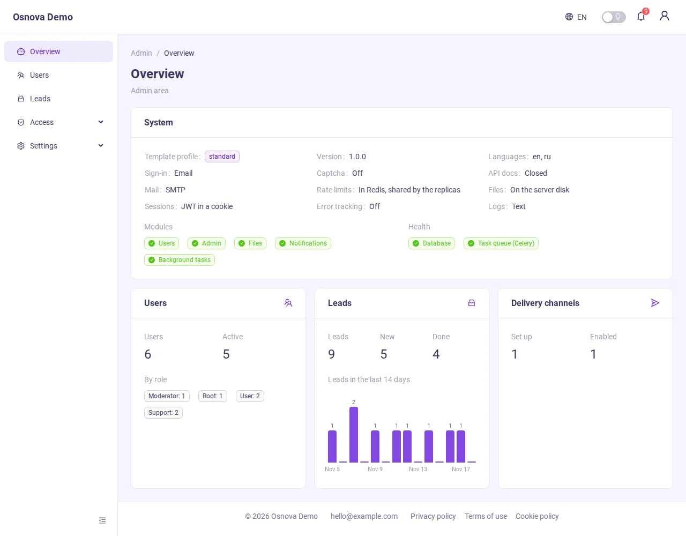
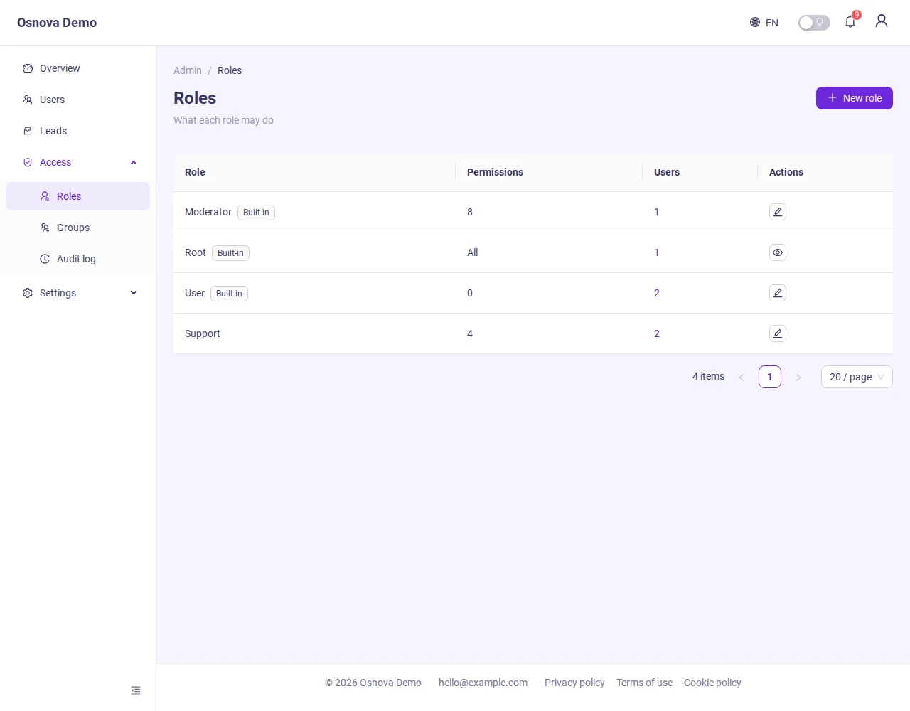
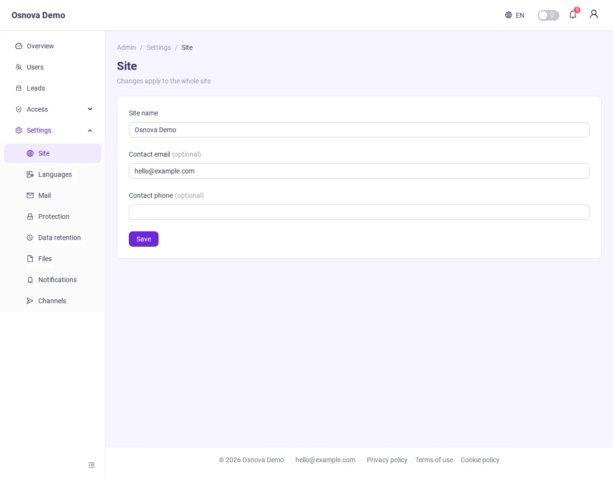

# Osnova

[](https://github.com/osnova-kit/osnova_backend/actions/workflows/ci.yml)
[](LICENSE)

**A modular full-stack template for web applications on FastAPI and React.**

Start a site, a client portal or a SaaS with what nearly every project needs already in
place: sign-in and accounts, an admin with roles and permissions, forms and leads, email,
files, languages, Docker, HTTPS, backups and CI. Switch capabilities on in `.env`, delete
the ones you do not need with one command, and take new releases of the template later
without losing your changes.

<p>
  
  
</p>
<p>
  
  
</p>
<p>
  
  
</p>

## What you get

- **Three profiles, one codebase.** `minimal` (a site without a database), `standard`
  (PostgreSQL, Redis, Celery), `scalable` (several backend replicas). Growing changes
  configuration, not the architecture.
- **Modules by flags.** Users, admin, files, notifications, background tasks: each is a
  folder loaded only when enabled. `make strip` and `npm run strip` remove the unused ones.
- **Accounts.** Sign-up with email confirmation, password reset, Google, sessions in a JWT
  cookie or Redis, a profile that changes the password and email, signs out everywhere and
  deletes the account.
- **Admin with real access control.** Named permissions, roles and groups edited in the
  admin, an audit log, users, leads with CSV export, delivery channels, settings.
- **Settings in the admin, not in code.** Typed groups (site, languages, mail, captcha and
  limits, retention, files, notifications) with forms generated from the model; secrets
  stored encrypted.
- **Forms and leads.** A form is described once on the backend and rendered by the
  frontend; submissions are stored and sent to email, Telegram or a webhook, with retries.
- **Languages and SEO.** English and Russian, the language in the URL, translated emails,
  prerendered tags, `hreflang`, link previews, sitemap.
- **Production.** Docker Compose, HTTPS with Caddy, security headers, JSON logs, request
  ids, readiness checks, backups, optional Sentry, rate limits shared by replicas.
- **Quality.** ruff and Biome, pytest and Vitest, Playwright end-to-end tests, a CI that
  starts the whole stack, Dependabot.
- **Upgrades.** `make upgrade VERSION=...` merges a new release of the template into your
  project; semantic versioning tells you what to expect.

| Repository | Purpose | Stack |
|---|---|---|
| **osnova_backend** (this one) | API, business logic, data | Python 3.13 · FastAPI · SQLAlchemy · PostgreSQL · Celery · Redis |
| [**osnova_frontend**](https://github.com/osnova-kit/osnova_frontend) | Web interface (SPA) | React 19 · TypeScript · Vite · Ant Design |

## Quick start

Requirements: Docker with the Compose plugin, `git`, `make`, `python3`.

```bash
git clone https://github.com/osnova-kit/osnova_backend.git
git clone https://github.com/osnova-kit/osnova_frontend.git   # next to it
cd osnova_backend
make init          # .env: standard profile, every capability on, random secrets
make up-standard   # builds and starts everything, applies the migrations
make createroot    # the first user (asks for an email and a password)
```

Open `http://localhost:8080`, sign in, and the admin is at `/admin`.

## Documentation

[DOCUMENTATION.md](DOCUMENTATION.md): profiles, modules, configuration, the API, users and
permissions, forms, email, settings, files, tasks, Docker, deployment to a server with
HTTPS, backups, upgrading, development. The interface:
[osnova_frontend/DOCUMENTATION.md](https://github.com/osnova-kit/osnova_frontend/blob/main/DOCUMENTATION.md).

## Contributing and license

Changes: [CHANGELOG.md](CHANGELOG.md). Contributing: [CONTRIBUTING.md](CONTRIBUTING.md);
security: [SECURITY.md](SECURITY.md). License: [MIT](LICENSE).
